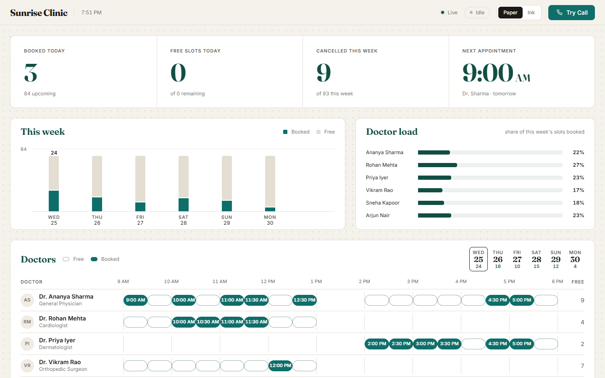

# Sunrise Clinic: voice appointment assistant

[](https://github.com/PuliHarshith/voice-doctor-agent/actions/workflows/ci.yml)

A voice receptionist you talk to in the browser: it checks doctors' free slots, books and cancels appointments, and a live dashboard shows every step.

Demo video: (link)

You talk to Ava, a receptionist, from your browser. She can check a doctor's free slots, book an appointment and cancel one. She knows who you are only from the phone number you say. She reads it back digit by digit, and nothing is booked or cancelled until you say yes.

- **Voice pipeline:** Pipecat 1.17 (Python), in `backend/`
- **Speech to text:** ElevenLabs Scribe v2 Realtime (streaming, English)
- **Text to speech:** ElevenLabs Flash v2.5, voice "Sarah"
- **LLM:** Google Gemini, `gemini-3.5-flash-lite` (free tier from Google AI Studio)
- **Turn detection:** Silero VAD plus Pipecat's Smart Turn v3 model, both running locally
- **Data:** SQLite with six mock doctors, a week of slots and a demo week of bookings, seeded automatically
- **Dashboard:** React 19, Vite and TypeScript, in `frontend/`

How the parts fit together is in [PIPELINE.md](PIPELINE.md).

## Screenshot



## Run it

You need Python 3.11, Node 20 or newer, an ElevenLabs API key and a Google AI Studio API key. Both keys have free plans.

### 1. Backend (port 7860)

Windows (PowerShell):

```powershell
cd backend
py -3.11 -m venv .venv
.venv\Scripts\Activate.ps1        # if scripts are blocked: Set-ExecutionPolicy -Scope Process Bypass
pip install -r requirements.txt
copy .env.example .env            # then put your two keys in .env
python bot.py
```

macOS / Linux:

```bash
cd backend
python3.11 -m venv .venv
source .venv/bin/activate
pip install -r requirements.txt
cp .env.example .env              # then put your two keys in .env
python bot.py
```

The server is ready when it prints a line with `http://localhost:7860`. It makes no API calls until you start a call.

The first start creates `clinic.db` with six doctors, a week of slots and a realistic spread of demo bookings. To reset the demo data at any time, run `python seed.py` (the same week every time; the demo caller's number, 98765 43210, is never pre-booked).

### 2. Dashboard (port 5173)

```bash
cd frontend
npm install
npm run dev
```

Open http://localhost:5173 and click **Try Call**, then allow the microphone. Vite forwards `/api`, `/start` and `/sessions` to the backend, so there's nothing else to set up.

### Try saying

> "I'd like to see a dermatologist tomorrow afternoon."
> "My number is 98765 43210." *(Ava reads it back. Say yes, or no and correct it.)*
> "Two thirty is fine."
> "Actually, cancel that appointment."

The dashboard updates while you talk: the slot is stamped onto the doctor's lane, the week chart and doctor load move, the booking appears at the top of Appointments, and a cancelled booking stays in the list, struck through. The call sheet shows the confirmed number digit by digit and the last reply time. The search box above Appointments finds a patient's bookings by phone number (spaces optional) or by doctor, and the top row counts down to the next booked visit.

## Tests

```bash
cd backend
python -m pytest                  # with the .venv from step 1 active
```

These cover parsing of spoken phone numbers, the read-back check and the four tools (availability, number confirmation, booking, cancelling) against a temporary database. They make no API calls.

## Configuration

Only the two keys are required. Everything else in [`backend/.env.example`](backend/.env.example) is optional and documented line by line: model, voice, and how long a pause ends your turn. **`.env` is git-ignored. Never commit it.**

## Known limitations

- **Response time:** Ava starts answering 1.8–2.9 s after you stop talking, or 3–5 s when she has to look something up. Most of that is Gemini, which varies from 0.6 to 2.5 s per reply.
- **Voice:** the free ElevenLabs plan only allows its built-in voices, so the voice can't be changed to one from the Voice Library.
- **Talking over Ava:** if you interrupt her while she's reading the number back, she asks you to confirm it again. This is deliberate.
- **One caller at a time:** the dashboard is a single shared view, and is meant for local use.
